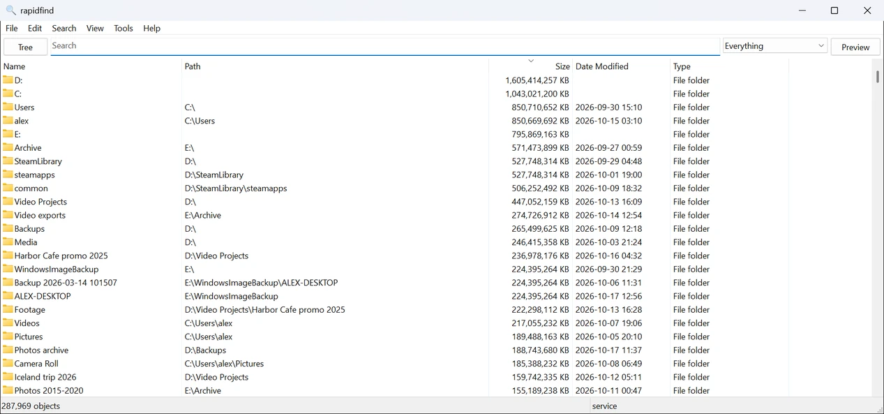
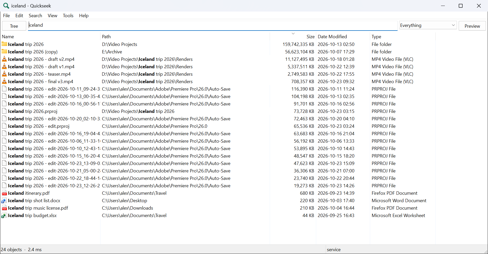
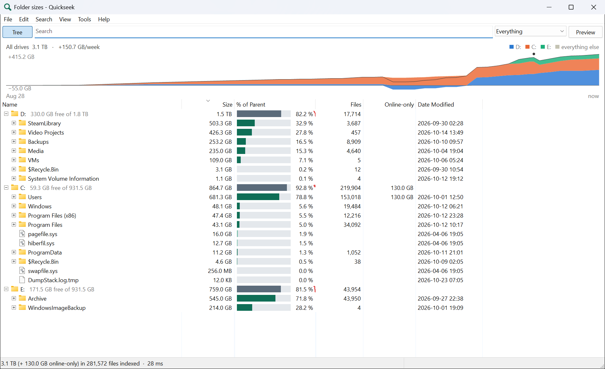
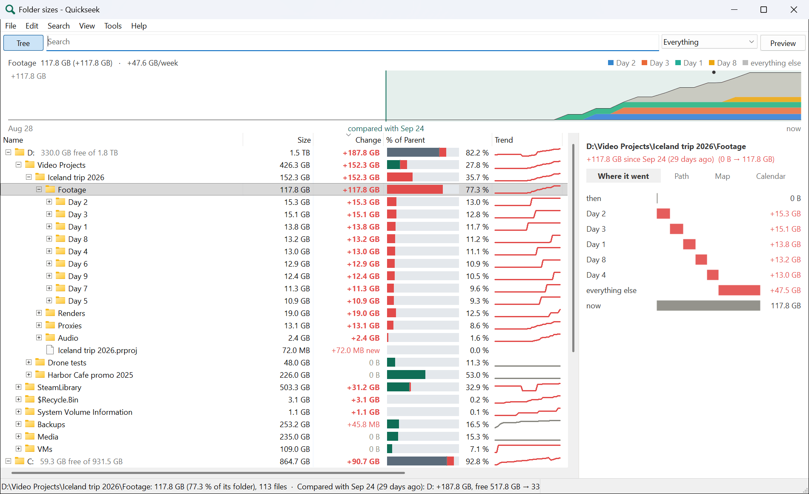
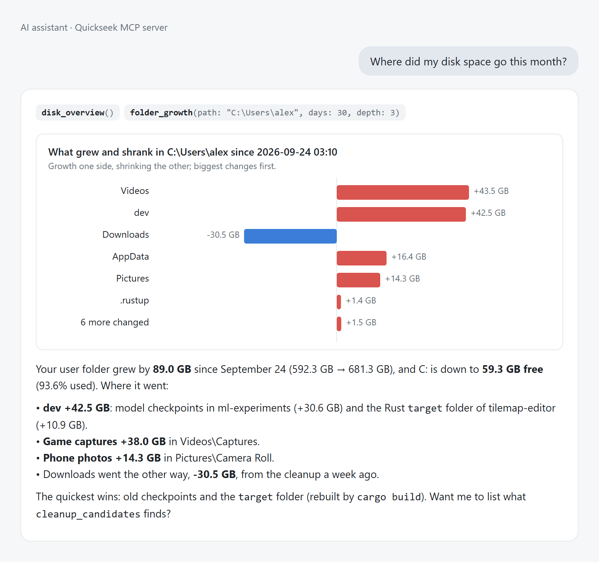
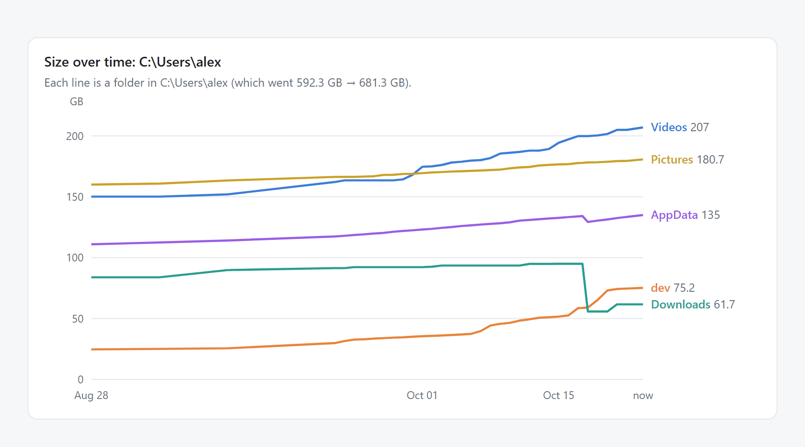

# rapidfind

**Find any file on your Windows PC as you type, see where your disk space went, and let your AI
assistant answer both.**

<p align="center">
  
</p>

## What it does for you

| | |
|---|---|
| **Instant search on every drive** | Millions of files on every NTFS and ReFS drive, and on USB drives or network shares if you add them, searched as you type, by name, folder, wildcard, size or date, or by the text inside. The index stays current on its own. |
| **Where did my space go?** | A live folder-size tree of every drive, and daily snapshots that show what grew or shrank since yesterday, last week or before a cleanup: a timeline, a "where it went" breakdown, a treemap and a calendar. |
| **Your AI assistant can use it** | An MCP server lets Claude, Codex, Cursor, VS Code and others find files, explain what fills a drive (with a chart), suggest what to clean up and, with your OK, move it to the Recycle Bin. |

## Install

```powershell
winget install OssianHanning.rapidfind
```

Or download `rapidfind-setup-<version>-x64.exe` from [Releases](../../releases) and run it. It installs
to `C:\Program Files\rapidfind`: a background service that keeps the index (so searching needs no
admin rights), the window with a Start menu entry and a global hotkey (`Ctrl+Alt+Space`), the
`rapidfind` command, and it connects the AI assistants it finds. Windows 10 or 11, 64-bit.

## A quick tour

**Search.** Results appear as you type, sorted however you like, with the Explorer context menu,
drag and drop and a preview pane. [Query syntax](docs/user-guide.md#query-syntax) covers wildcards
across folders (`users\*\*.pdf`), `ext:`, `size:>1gb`, `dm:lastweek`, duplicates and `content:`.



**Folder sizes.** The tree (`Ctrl+T`) shows every drive and folder by size, live, with what's free
on each drive. Type in the search box to count only matching files, for example `*.mp4` for where
the videos are.



**What grew.** Compare with yesterday, a week or a month ago: each folder shows its change and a
trend line. The pane on the right breaks down where the growth went, as a waterfall, a treemap or a
calendar.



**Ask your AI assistant.** "Where did my disk space go this month?" The assistant asks rapidfind
and gets the answer with a ready-made chart, which it can draw if it renders charts.



<details><summary>The chart data it gets</summary>

Disk-space results start with a `present` field: the chart type, a title and the data, ready to
plot. Here, the size of each folder over the last snapshots:


</details>

All images come from a made-up demo PC ([how](docs/development.md#the-demo-pc)), not anyone's files.

## AI assistants

`rapidfind-mcp` works with any MCP client. These are connected automatically by the installer, from
the window (Tools → Connect AI Assistants) or with `rapidfind mcp install`:

| Client | How |
|---|---|
| Claude Code | `claude mcp add`, plus a rapidfind skill |
| Claude Desktop | its config file, or the `.mcpb` extension from Releases |
| Codex | `~/.codex/config.toml` (comments kept), plus a rapidfind skill |
| Cursor | `~/.cursor/mcp.json` |
| VS Code (and Insiders) | the user `mcp.json` (agent mode) |
| Windsurf | `~/.codeium/windsurf/mcp_config.json` |
| Antigravity | `~/.gemini/config/mcp_config.json` |

Tools: `search_files`, `folder_sizes`, `folder_growth`, `disk_overview`, `cleanup_candidates`,
`delete_paths` (Recycle Bin by default, refuses system folders) and `empty_recycle_bin`. See
[the MCP section](docs/user-guide.md#mcp-server-rapidfind-mcp) of the user guide.

## Privacy

- **Everything stays on your PC.** rapidfind has no telemetry, no update check and no cloud. It
  makes no network connections, except to the network shares you add yourself.
- The index holds names, sizes and dates, not file contents. Content search reads files on demand,
  as you, and never in the service.
- **An AI assistant sees what it asks for.** When you connect one, the file names and sizes it gets
  from rapidfind go wherever that assistant sends its conversation (often its vendor's cloud).
  rapidfind tells the assistant to show what would go and ask before deleting (most clients also
  confirm each tool call), and deletions go to the Recycle Bin unless you ask otherwise.
- Any user signed in to the PC can search every indexed file name, as with Everything's service.
  See [service security](docs/user-guide.md#service-security).

## Compared with Everything

[Everything](https://www.voidtools.com/) is the classic instant file search for Windows, and an
inspiration. Measured on one PC with about 7 million files ([details](docs/benchmarks.md)):

| | rapidfind | Everything |
|---|---|---|
| Typical searches (substring, `*.pdf`, `size:>1gb`) | 6–14 ms | 10–38 ms |
| Path wildcards (`*\system32\*.dll`) | 36 ms | 291 ms |
| Millions of results sorted by name | 155–200 ms | 31–45 ms |
| Memory for ~7M files | ~580 MB | ~580 MB |
| Index on disk | 90 MB | 260 MB |
| Folder sizes, history of what grew | yes | folder sizes only |
| AI assistants (MCP) | yes | no |
| Maturity and ecosystem | new | since 2009; SDK, `es.exe`, plugins, HTTP/ETP servers |

## Details

**Command line.** `rapidfind` alone is a terminal search-as-you-type; there's more:

```powershell
rapidfind search -l -s size -d "ext:mp4 size:>1gb"   # biggest videos
rapidfind du C:\Users -d 2                           # biggest folders, two levels
rapidfind history growth C:\Users --days 7           # what grew this week
rapidfind status                                     # service, drives, index
```

All commands and options are in the [user guide](docs/user-guide.md#command-line).

**Uninstall.** Apps & Features, or `winget uninstall OssianHanning.rapidfind`. Your index and
settings in `%ProgramData%\rapidfind` stay, for a later reinstall; `rapidfind-setup.exe --uninstall
--purge` removes them too.

**Build from source.** Rust stable (MSVC) on Windows: `cargo build --release`. See
[development](docs/development.md) for tests, the demo PC, releases and the
[architecture notes](docs/architecture.md) on how it gets its speed.

## License

Dual-licensed under [MIT](LICENSE-MIT) or [Apache-2.0](LICENSE-APACHE), at your option.
Third-party licenses are in [THIRD-PARTY.md](THIRD-PARTY.md). Releases are built and signed only by CI ([code signing policy](CODE_SIGNING.md)).
